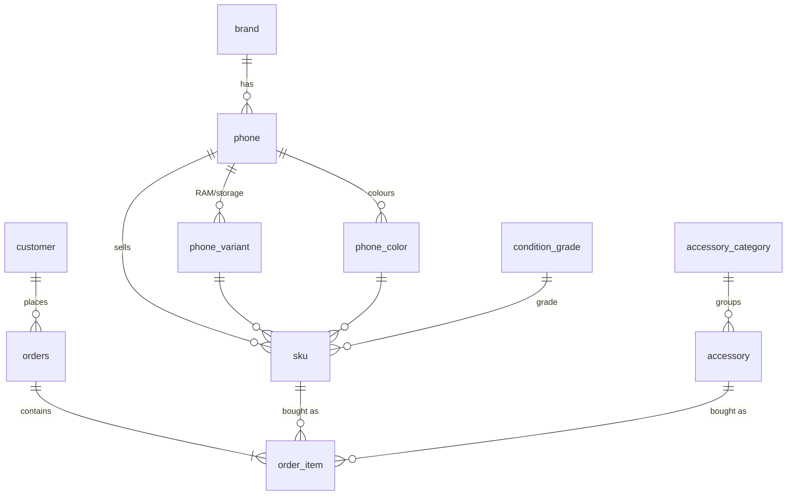

# MobiNest: Database

MySQL **8.0.45** · schema **`mobinest`** · charset `utf8mb4` / collation `utf8mb4_0900_ai_ci` · engine InnoDB
App user: **`mobinest_app`@localhost** (SELECT, INSERT, UPDATE, DELETE, CREATE, ALTER, DROP, INDEX, REFERENCES on `mobinest.*` only).
Schema owner: **Flyway** (`src/main/resources/db/migration`), current version **v7** (V4 iPhone Duo, V5 rebrand texts, V6 iPhone 18 Pro Max, V7 admin back office: `order_status_history`, `admin_audit_log`, see [ADMIN.md](ADMIN.md)).

## 1. Live statistics

**Latest snapshot (12 Nov 2026, 16:00 IST):**

| | All data | Visible in store |
|---|---:|---:|
| Brands | 12 | 3 (Apple, Samsung, Google Pixel) |
| Phones | 34 | 18 (incl. the new iPhone Duo and iPhone 18 Pro Max) |
| SKUs | 494 | 308 |
| Phone units in stock | 7,310 | |
| Orders | 6 test orders | |
| Customers | 0 | (created on a signed-in user's first API call) |

Test orders, all guests:
- `MNMWBYYOZCWMIP` (₹89,497, UPI)
- `MNMWBZJEATG1IG` (₹44,999, UPI)
- `MNMWDCH4O7KZS7` (₹34,298, COD)
- `MNMWDDPEB1IWB1` (₹3,24,399, UPI)
- `MNMWDDS7EGSRYP` (₹44,999, COD)
- `MNMWDE33X4Z279` (₹3,24,399, UPI)

Remove them before a public demo (`DELETE FROM orders;`; stock is not restored automatically).

_The tables below are the earlier snapshot (11 Nov 2026, after V3); counts have grown since, as above._

**Store visibility (V3):** only **3 of 12 brands are active**: Apple, Samsung, Google Pixel (the owner's current focus). Phones of the other 9 brands stay in the database but are hidden from the API and can't be ordered.

| What | All data | Visible in store |
|---|---:|---:|
| Brands | 12 | **3** |
| Phones | 32 | **16** |
| SKUs | 470 | **284** |
| Phone units in stock | 6,714 | **4,051** |

| Table | Rows | Size (KB) | What it holds |
|---|---:|---:|---|
| `brand` | 12 (3 active) | 32 | Active: Apple, Samsung, Google Pixel · Inactive: OnePlus, Xiaomi, Vivo, OPPO, Nothing, Motorola, realme, iQOO, POCO |
| `condition_grade` | 4 | 16 | new, refurbished, used, recycled |
| `phone` | 32 | 48 | Phone models |
| `phone_variant` | 67 | 32 | RAM/storage options with launch price |
| `phone_color` | 101 | 32 | Colour options |
| `sku` | **470** | 224 | Sellable units (variant x colour x condition) with price and stock |
| `accessory_category` | 8 | 16 | cases, screen-guards, chargers, cables, audio, power-banks, wearables, mounts |
| `accessory` | 17 | 48 | Accessories |
| `coupon` | 3 | 16 | WELCOME10, MOBI1000, ACCESS20 |
| `customer` | 0 | 32 | Created when a signed-in Clerk user first calls the API |
| `orders` | 3 | 48 | Guest test orders: `MNMWBYYOZCWMIP` (₹89,497, backend curl test, UPI PAID), `MNMWBZJEATG1IG` (₹44,999, frontend browser end-to-end test, UPI PAID), `MNMWDCH4O7KZS7` (₹34,298, integration check through the proxy, 12 Nov, COD PENDING) |
| `order_item` | 3 | 64 | Lines of the test orders |
| `flyway_schema_history` | 3 | 32 | V1 catalog, V2 customers/coupons/orders, V3 brand visibility |

**Visible stock by condition** (active brands only)

| Condition | SKUs | Units | Price range (₹) |
|---|---:|---:|---|
| new | 123 | 3,072 | 39,899 – 1,89,900 |
| refurbished | 66 | 528 | 32,799 – 1,19,099 |
| used | 71 | 355 | 25,499 – 97,699 |
| recycled | 24 | 96 | 21,799 – 41,499 |
| **Visible phones total** | **284** | **4,051** | |
| Accessories | 17 | 849 | 499 – 3,999 |

**By brand**

| Brand | Active | Phones | SKUs | Units |
|---|:---:|---:|---:|---:|
| Apple | ✅ | 7 | 145 | 2,026 |
| Samsung | ✅ | 6 | 114 | 1,582 |
| Google Pixel | ✅ | 3 | 25 | 443 |
| OnePlus | — | 3 | 44 | 687 |
| Xiaomi | — | 2 | 33 | 405 |
| Vivo | — | 2 | 24 | 346 |
| OPPO | — | 2 | 8 | 166 |
| Nothing | — | 2 | 26 | 336 |
| Motorola | — | 2 | 15 | 255 |
| realme | — | 1 | 12 | 136 |
| iQOO | — | 1 | 12 | 152 |
| POCO | — | 1 | 12 | 180 |

Demo stock per SKU at seed time: new 25 · refurbished 8 · used 5 · recycled 4 · each accessory 50. The test orders took 3 units of Pixel 9a (Iris, new) and 1 ClearGuard MagSafe Case.

Turn a brand back on: `UPDATE brand SET active = TRUE WHERE slug = 'oneplus';` (takes effect immediately, no restart). For a permanent change, add a Flyway migration.

To refresh these numbers:
```sql
SELECT table_name, table_rows, ROUND((data_length+index_length)/1024) kb
FROM information_schema.tables WHERE table_schema='mobinest' ORDER BY table_name;
SELECT condition_code, COUNT(*) skus, SUM(stock) units, MIN(price), MAX(price) FROM sku GROUP BY condition_code;
```

## 2. ER diagram



## 3. Tables

### Catalogue (V1)

**brand**: `id` PK · `slug` UNIQUE (e.g. `apple`) · `name` · `tagline` · `accent_hex` · `sort_order` · `active` (V3; only active brands and their phones are shown and sold) · `hero_phone_slug` + `hero_color` (V3; phone featured on the brand tile)

**condition_grade**: `code` PK (`new`/`refurbished`/`used`/`recycled`) · `label` · `short_label` · `price_factor` DECIMAL(4,3) · `warranty` · `description` · `color_hex` · `sort_order`

**phone**: `id` PK · `slug` UNIQUE (`iphone-17-pro-max`) · `brand_id` FK → brand · `name` · `release_year` · `camera_style` (UI drawing style) · `five_g` · `discount` DECIMAL(4,3) (0.120 = 12% off launch price) · `rating` DECIMAL(2,1) · `review_count` · `specs` JSON (display, processor, rearCamera, frontCamera, battery, charging, os, weight) · `highlights` JSON · `tags` JSON (`new-launch`, `bestseller`, ...) · `active` · `created_at` · `updated_at`

**phone_variant**: `id` PK · `phone_id` FK (cascade) · `position` (0 = cheapest; the React app uses this index) · `ram_gb` · `storage_gb` · `mrp` DECIMAL(12,2) · UNIQUE(`phone_id`,`position`)

**phone_color**: `id` PK · `phone_id` FK (cascade) · `position` · `name` · `hex` · UNIQUE(`phone_id`,`name`)

**sku**: `id` PK · `sku_code` UNIQUE (`pixel-9a/8-256/iris/new`) · `phone_id`, `variant_id`, `color_id` FKs (cascade) · `condition_code` FK → condition_grade · `price` · `mrp` · `stock` · UNIQUE(`variant_id`,`color_id`,`condition_code`) · **CHECK (`stock >= 0`)**

**accessory_category**: `code` PK · `name` · `icon` · `sort_order`

**accessory**: `id` PK · `slug` UNIQUE · `name` · `brand_label` (house brand) · `category_code` FK · `price` · `mrp` · `rating` · `review_count` · `description` · `features` JSON · `colors` JSON `[{name,hex}]` · `compatible_brands` JSON (brand slugs or `["all"]`) · `stock` CHECK ≥ 0 · `active` · timestamps

### Brand visibility (V3)
`V3__brand_visibility.sql` adds `brand.active`, `hero_phone_slug` and `hero_color`, sets only apple/samsung/google active, and copies the frontend's new taglines plus the "Google Pixel" name. On a fresh install the seeder sets the same values from `seed/brands.json`. Verified: a fresh install and the upgraded live DB return an identical catalogue.

### Customers, coupons, orders (V2)

**customer**: `id` PK · `clerk_user_id` UNIQUE (JWT `sub`) · `email` · `full_name` · `role` (`CUSTOMER`/`ADMIN`) · timestamps

**coupon**: `code` PK · `description` · `discount_type` (`PERCENT`/`FLAT`) · `discount_value` · `max_discount` · `min_subtotal` · `max_subtotal` · `active` · `valid_until`

**orders**: `id` PK · `order_number` UNIQUE · `customer_id` FK (NULL = guest) · `email` · `status` (`CONFIRMED`/`SHIPPED`/`DELIVERED`/`CANCELLED`) · `payment_method` (`UPI`/`CARD`/`EMI`/`NETBANKING`/`COD`) · `payment_status` (`PENDING`/`PAID`/`FAILED`/`REFUNDED`) · `payment_reference` · `coupon_code` · `subtotal` · `mrp_total` · `coupon_discount` · `shipping_fee` · `total` · `item_count` · `ship_full_name`, `ship_phone`, `ship_email`, `ship_address`, `ship_landmark`, `ship_city`, `ship_state`, `ship_pincode` (address snapshot) · `estimated_delivery` DATE · timestamps · INDEX(`customer_id`,`created_at`)

**order_item**: `id` PK · `order_id` FK (cascade) · `item_type` (`PHONE`/`ACCESSORY`) · `product_slug` · `sku_id` FK / `accessory_id` FK · `line_key` (`type|productId|variantIndex|color|condition`, same as the React cart) · snapshot: `name`, `details`, `condition_label`, `color_name`, `color_hex`, `unit_price`, `unit_mrp` · `quantity` CHECK 1..5

## 4. Conventions

- Money: `DECIMAL(12,2)` in rupees, `BigDecimal` in Java.
- Timestamps: `DATETIME(6)` stored in **UTC**. Example: 15:51 IST is stored as 10:21.
- Public identifiers are **slugs** (phones, accessories, brands) and **order numbers**; numeric ids stay internal.
- JSON columns are used for flexible, display-only data (specs, highlights, tags, colours, features).
- Schema changes go **only** through new Flyway files (`V3__description.sql`, ...). Never edit an applied migration.

## 5. Seed data

- Source: the React draft's `src/data/*.js`, exported to `src/main/resources/seed/*.json` with `context/tools/export-seed-from-frontend.mjs`. The tool exports **all** brands and phones (the frontend's private `ALL_BRANDS`/`ALL_PHONES`), with `active` per brand.
- Loaded by `CatalogSeeder` **only when the `brand` table is empty**. Disable with `SEED_ENABLED=false`.
- Coupons are inserted by migration `V2`.
- ⚠️ Specs and prices are approximate sample data. Verify them before launch.

## 6. Common operations

```powershell
# open a SQL shell as the app user (the password is in config/application.properties)
& "C:\Program Files\MySQL\MySQL Server 8.0\bin\mysql.exe" -u mobinest_app -p mobinest
```

| Task | How |
|---|---|
| Reset everything | As root: `DROP DATABASE mobinest;` → run `context/setup/setup-database.ps1` → start the API (recreates and re-seeds) |
| Delete only the test orders | `DELETE FROM orders;` (items cascade). Stock is **not** restored automatically. |
| Restock a SKU | `UPDATE sku SET stock = 25 WHERE sku_code = 'pixel-9a/8-256/iris/new';` |
| Add a coupon | `INSERT INTO coupon (code, description, discount_type, discount_value, min_subtotal) VALUES ('DIWALI5','5% off','PERCENT',5,0);` (for a permanent change, add a Flyway migration) |
| Backup | `mysqldump -u root -p mobinest > mobinest-backup.sql` |
