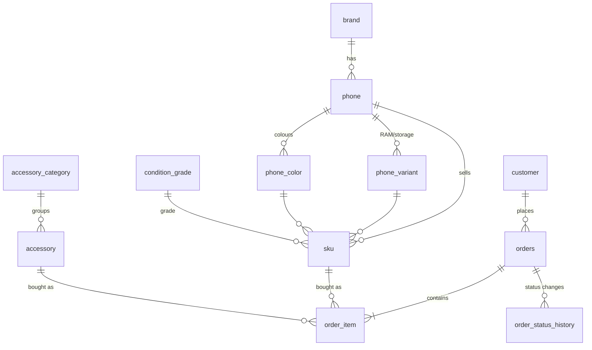

# Namma Mobiles: The Complete Project Guide

> **One file to understand, run and extend the whole project.**
> Audience: students and developers who receive this project as a zip. No prior chat history needed.
> Last updated: **12 Nov 2026**. Detailed companion docs live next to this file in `mobinest-api/context/`.

---

## Table of contents
1. [What this project is](#1-what-this-project-is)
2. [What's in the zip](#2-whats-in-the-zip)
3. [Run it on your machine (step by step)](#3-run-it-on-your-machine-step-by-step)
4. [Tech stack](#4-tech-stack)
5. [Architecture](#5-architecture)
6. [Frontend guide (React)](#6-frontend-guide-react)
7. [Backend guide (Spring Boot)](#7-backend-guide-spring-boot)
8. [Database (MySQL + Flyway)](#8-database-mysql--flyway)
9. [API reference (summary)](#9-api-reference-summary)
10. [Authentication & the admin side](#10-authentication--the-admin-side)
11. [Payments (Razorpay + UPI)](#11-payments-razorpay--upi)
12. [Testing](#12-testing)
13. [Common tasks (how-to recipes)](#13-common-tasks-how-to-recipes)
14. [Troubleshooting](#14-troubleshooting)
15. [Key design decisions (and why)](#15-key-design-decisions-and-why)
16. [How the project was built (timeline)](#16-how-the-project-was-built-timeline)
17. [Open items & roadmap](#17-open-items--roadmap)
18. [Legal, licences & secrets](#18-legal-licences--secrets)

---

## 1. What this project is

**Namma Mobiles** is a full-stack e-commerce web app for India that sells **only mobile phones** (and matching accessories), in four conditions: **Brand New, Certified Refurbished, Pre-owned and Eco Recycled**, each with a warranty.

Customers can browse by brand, condition and price, compare phones, keep a wishlist, add phones and accessories to a cart, apply coupons, check out (guest or signed in), see their orders, and get an instant trade-in quote for an old phone. Admins get a separate dashboard for orders, payments, catalogue, coupons and customers.

| Part | Folder | What it does |
|---|---|---|
| **Frontend** | `mobinest/` | React single-page app (the storefront + admin UI) on **http://localhost:5173** |
| **Backend** | `mobinest-api/` | Spring Boot REST API on **http://localhost:8080** (Swagger UI at `/swagger-ui.html`) |
| **Database** | MySQL schema `mobinest` | Catalogue, stock, coupons, customers, orders (managed by Flyway migrations) |
| **Auth** | Clerk (hosted) | Sign-in / sign-up; the API verifies Clerk's tokens |

> The internal code name is **MobiNest** (folder names, Java package `com.mobinest`, localStorage keys). The customer-facing brand is **Namma Mobiles**.

---

## 2. What's in the zip

```
NammaMobiles/
├── NAMMA-MOBILES-COMPLETE-GUIDE.md   ← this file
├── mobinest/                         ← React frontend (no node_modules; run npm install)
│   └── .env.example                  ← copy to .env.local and add YOUR Clerk publishable key
└── mobinest-api/                     ← Spring Boot backend (no target/, no config/ secrets)
    └── context/                      ← detailed docs, setup scripts, tools
        ├── README.md · CONTEXT.md · PROJECT.md · DATABASE.md · API.md · ADMIN.md · PAYMENTS.md · CHANGELOG.md
        ├── setup/   setup-database.ps1 · start-mobinest.ps1 · templates
        ├── tools/   export-seed-from-frontend.mjs · e2e/ (end-to-end test)
        └── quarantine/razorpay-draft/   ← unfinished Razorpay code, kept for reference (not compiled)
```

**Deliberately NOT included** (you create your own): `node_modules/`, `target/`, `mobinest-api/config/` (database password), `mobinest/.env.local` (Clerk keys), git history.

---

## 3. Run it on your machine (step by step)

Tested on **Windows 11**. macOS/Linux work too; use the bash equivalents of the PowerShell commands.

### 3.1 Install the prerequisites

| Tool | Version | Windows install | Check |
|---|---|---|---|
| JDK | **25** | `winget install --id EclipseAdoptium.Temurin.25.JDK -e` | `java -version` |
| MySQL Server | **8.x** | `winget install --id Oracle.MySQL -e`, then set a root password in MySQL Configurator | `Get-Service *mysql*` → Running |
| Node.js | **22.15+** (LTS) | `winget install OpenJS.NodeJS.LTS` | `node -v` |
| Git (optional) | any | `winget install Git.Git` | `git --version` |

You do **not** need Maven or Tomcat: the backend ships the Maven wrapper (`mvnw.cmd`) and Spring Boot embeds Tomcat. Open a **new** terminal after installing the JDK.

### 3.2 Create your own Clerk app (free, 5 minutes)

The original Clerk keys are private, so every student uses their own:

1. Sign up at **https://clerk.com** → **Create application** (name it e.g. "NammaMobiles"), and enable Email (and optionally Google) sign-in.
2. In the Clerk Dashboard → **API keys** (React / Vite), copy:
   - the **Publishable key** (`pk_test_...`), which goes to the frontend;
   - the **Frontend API URL** (e.g. `https://your-app-123.clerk.accounts.dev`), which goes to the backend as `CLERK_ISSUER`.
3. Frontend: copy `mobinest/.env.example` to `mobinest/.env.local` and set
   ```
   VITE_CLERK_PUBLISHABLE_KEY=pk_test_xxxxxxxxxxxxxxxxx
   ```
4. Backend: tell the API which Clerk instance to trust. Either set an environment variable before starting it:
   ```powershell
   $env:CLERK_ISSUER = "https://your-app-123.clerk.accounts.dev"
   ```
   or add `mobinest.clerk.issuer=https://your-app-123.clerk.accounts.dev` to `mobinest-api/config/application.properties` (created in the next step).

> Without these, the shop still works for **guests** (browse, cart, guest checkout); sign-in, "My orders" and the admin area need Clerk.

### 3.3 Create the database (one time)

```powershell
cd NammaMobiles\mobinest-api
powershell -ExecutionPolicy Bypass -File context\setup\setup-database.ps1
# asks for your MySQL root password (hidden input)
```
This creates the `mobinest` database and a limited user `mobinest_app` with a random password. It also writes `config/application.properties`, which is git-ignored; never share it. Tables are **not** created here: Flyway creates them when the API first starts.

### 3.4 Install frontend packages (one time)

```powershell
cd ..\mobinest
npm install
```

### 3.5 Start everything

**Option A: one command** (starts MySQL if needed, then the API, then the shop, each in its own window):
```powershell
powershell -ExecutionPolicy Bypass -File ..\mobinest-api\context\setup\start-mobinest.ps1
```
**Option B: two terminals:**
```powershell
# terminal 1
cd mobinest-api ; .\mvnw.cmd spring-boot:run      # first run downloads dependencies (a few minutes)
# terminal 2
cd mobinest ; npm run dev                         # opens http://localhost:5173
```

On the **first** API start, Flyway runs migrations **V1–V7** and the **CatalogSeeder** loads the sample catalogue: 12 brands (3 active: Apple, Samsung, Google Pixel), 34 phones (18 visible), about 494 SKUs, 17 accessories and 3 coupons.

### 3.6 Check it works

| Open | Expect |
|---|---|
| http://localhost:8080/actuator/health | `{"status":"UP"}` |
| http://localhost:8080/swagger-ui.html | Interactive API docs |
| http://localhost:5173 | The Namma Mobiles storefront (hero with iPhone 18 Pro Max) |
| Sign up on the site | Clerk modal; afterwards the header shows your avatar and "Orders" |
| Add a phone to the cart, then checkout as guest with UPI | Order confirmation `MN…`; the order is saved in MySQL |
| `cd mobinest-api ; .\mvnw.cmd test` | Unit tests pass (the context-load test needs MySQL running) |

### 3.7 Become an admin (optional)
See [section 10](#10-authentication--the-admin-side).

---

## 4. Tech stack

| Layer | Technology | Notes |
|---|---|---|
| Frontend framework | **React 19**, **Vite 8**, React Router 7 | JavaScript (JSX), not TypeScript |
| Styling | Hand-written CSS (`global.css`, design tokens) + **Tailwind CSS v4** utilities | Tailwind added in "safe mode" (no preflight), see 6.4 |
| UI components | **shadcn/ui** (radix base), **Aceternity UI** (Spotlight, Placeholders-and-Vanish search, Card Hover Effect), **Magic UI** (Animated Theme Toggler) | Installed through the shadcn CLI into `src/components/ui/` |
| Animation | `motion` (Framer Motion) | Search + brand-card hover |
| Font | **Plus Jakarta Sans** (self-hosted via `@fontsource-variable`) | |
| Auth | **Clerk** (`@clerk/react`, `@clerk/themes`) | Light/dark aware sign-in cards |
| Backend | **Spring Boot 4.1.2**, **Java 25**, Spring Security 7 (OAuth2 resource server), Spring Data JPA / **Hibernate 7**, Jackson 3, Bean Validation, springdoc-openapi 3 | Embedded Tomcat |
| Database | **MySQL 8**, **Flyway** migrations | `ddl-auto: none`: Flyway owns the schema |
| Build | npm (frontend), Maven wrapper (backend) | |
| Testing | JUnit 5 / AssertJ / Spring Security Test (backend), ESLint, Playwright-driven E2E (`context/tools/e2e`) | |

---

## 5. Architecture

```
 Browser ── React SPA (Vite :5173) ──/api (Vite proxy)──▶ Spring Boot API (:8080) ──JPA──▶ MySQL (mobinest)
   │            │ Clerk <SignIn/>                            │ SecurityFilterChain: verifies Clerk JWT
   │            │ getToken() → Authorization: Bearer <jwt>   │ ClerkRoleJwtConverter: ROLE_ADMIN from DB
   └──────── Clerk (hosted identity) ◀── JWKS public keys ────┘ Flyway migrations · CatalogSeeder
```

### 5.1 Request flow: browsing
1. On startup the React app calls **`GET /api/catalog`** once (brands, conditions, phones with prices per variant×condition, accessories) and hydrates its data modules (`src/data/*.js`).
2. If the API is down, the app **falls back** to bundled sample data, so the shop still renders (demo mode).

### 5.2 Request flow: checkout
1. The cart holds only the **selection** (phone id, variant index, colour, condition, qty), never prices.
2. `POST /api/orders` sends that selection plus the address, payment method and coupon (plus the Clerk token if signed in).
3. The server, in **one transaction**: looks up each SKU, **reserves stock atomically** (`UPDATE … WHERE stock >= qty`), snapshots name and price, computes subtotal, coupon, shipping (free from ₹499) and total, enforces the COD limit (₹50,000), links the customer, and saves.
4. It publishes `OrderPlacedEvent`; a listener runs **after commit** (email placeholder).
5. It returns `201` with the order. Any failure rolls everything back, and no stock is taken.

---

## 6. Frontend guide (React)

### 6.1 Folder map (`mobinest/src`)
```
main.jsx                 theme-init → fonts → Tailwind → global CSS → loadCatalog() → render <ThemedClerkProvider><App/>
App.jsx                  routes (React Router data router, lazy-loaded pages)
components/
  layout/                Header (logo, Aceternity search, theme toggle, Clerk buttons), AnnouncementBar (offers ticker),
                         SearchBar, Logo, Footer, CompareBar, Layout
  home/                  TrendingPhones (tabs), ShopByPrice, BrandGallery (official films)
  ui/                    shadcn/Aceternity/Magic UI components (button, spotlight, placeholders-and-vanish-input,
                         animated-theme-toggler)
  BrandHoverRow.jsx      "Pick your favourite" brand cards with Aceternity Card Hover Effect
  BrandLogo.jsx          Apple / Samsung / Google marks (single-colour SVG paths)
  ProductCard, ProductImage, Rating, Price, FilterPanel, Gallery, …
  brand-options/         5 alternative brand-card designs (preview page /design/brand-cards)
context/                 AuthContext (Clerk + orders), CartContext (useReducer + localStorage), ShortlistContext
                         (wishlist + compare), ToastContext, AppProviders
data/                    brands, phones, accessories, conditions (sample data + API hydration), promotions (ticker
                         texts), media (official video ids), imageManifest.json (generated)
lib/                     theme-init.js (dark mode before first paint), ThemedClerkProvider.jsx, utils.js (cn)
pages/                   Home, Shop, ProductDetail, Brands, BrandStore, Accessories, AccessoryDetail, Compare,
                         Wishlist, Cart, Checkout, OrderSuccess, Account, Login (Clerk), Sell, Help, NotFound,
                         DesignBrandCards, admin/** (admin UI)
services/                api.js (fetch wrapper, RFC 9457 errors, Bearer token), catalog.js (loads /api/catalog),
                         adminApi.js
styles/                  tailwind.css (Tailwind + shadcn theme), global.css (tokens + most styles), home-sections.css,
                         showcase.css, compare.css, brand.css, brand-options.css, admin.css
utils/                   catalog (search/filters/price buckets), pricing, checkout (coupon preview), format, images, specs
```

### 6.2 Routes
`/` · `/phones` (filters in the URL query) · `/phones/:id` · `/brands` · `/brands/:id` · `/accessories` · `/accessories/:id` · `/compare` · `/wishlist` · `/cart` · `/checkout` · `/order/:id` · `/sign-in/*` · `/sign-up/*` · `/account` (signed-in) · `/sell` · `/help/:topic` · `/design/brand-cards` (design preview, not linked) · `/admin/*` (admins only) · `*` 404.

### 6.3 State & data
- **Cart / wishlist / compare** live in React Context and are saved to `localStorage` (`mobinest:*` keys).
- **Prices are never stored in the cart**; they're always recalculated from the catalogue, and the server recalculates again at checkout.
- **Orders:** for signed-in users from `GET /api/orders/me`; guests' orders are cached locally after checkout.

### 6.4 Styling system (important for contributors)
- **Design tokens** are CSS variables in `global.css` `:root`, for example:
  - brand: `--primary` (logo blue **#0b5bd3**), `--primary-600/50/100`;
  - text and surfaces: `--ink`, `--text`, `--text-muted`, `--line`, `--bg`, `--surface`;
  - role tokens: `--card`, `--contrast-bg/fg`, `--chrome-bg`, `--header-bg`;
  - spacing and shape: `--s1…--s16`, radii, shadows.
- **Dark mode:** `html.dark { … }` redefines the tokens; components only use tokens. `lib/theme-init.js` applies the saved choice (or the OS preference) **before first paint**. The header toggle (Magic UI `AnimatedThemeToggler`) switches it with a circular reveal animation. Add `?theme=dark` to any URL to force it (handy for screenshots).
- **Tailwind "safe install":** `styles/tailwind.css` imports Tailwind's *theme* and *utilities* layers but **not preflight** (the global reset), so the hand-written CSS renders exactly as before. All Tailwind output sits in cascade layers, so unlayered app CSS always wins. shadcn's colour variables map onto the app tokens, so shadcn components follow the brand and dark mode.
- **Renamed tokens** (to avoid clashes with shadcn): `--muted` → `--text-muted`, `--accent` → `--brand-orange`.
- **Typography:** Plus Jakarta Sans for everything; headings 750–800 weight with tight tracking; tabular numbers for prices.

### 6.5 Notable UI pieces
- **Offers ticker** (`AnnouncementBar` + `data/promotions.js`): infinite CSS marquee that pauses on hover; a static row with reduced motion.
- **Header search:** Aceternity "Placeholders and Vanish Input", themed; rotating example searches, particle "vanish" on submit, and a live suggestions panel.
- **Hero:** Aceternity **Spotlight** glare; phones: Galaxy S25 Ultra, **iPhone 18 Pro Max (Burgundy)**, Pixel 10 Pro.
- **Brand cards:** Aceternity **Card Hover Effect**, a soft highlight that glides between cards.
- **Product images:** `public/images/phones/<phoneId>/<colour-slug>.webp` (1000px) and `-sm.webp` (480px); `npm run dev/build` regenerates `imageManifest.json`.

---

## 7. Backend guide (Spring Boot)

### 7.1 Package map (`mobinest-api/src/main/java/com/mobinest`)
```
config/      SecurityConfig (stateless JWT, CORS, rules), OpenApiConfig, AppProperties (mobinest.*)
common/      error/ (ApiException, NotFoundException, BusinessRuleException, GlobalExceptionHandler → RFC 9457),
             json/ (JSON column converters), web/ (PageResponse)
catalog/     domain (Brand, ConditionGrade, Phone, PhoneVariant, PhoneColor, Sku, AccessoryCategory, Accessory),
             repo, dto, service (CatalogService, CatalogMapper, PricingPolicy, PhoneSpecifications), web, seed
customer/    Customer (local profile keyed by Clerk user id, role CUSTOMER|ADMIN), CustomerService (JIT
             provisioning), CustomerRoleService + ClerkRoleJwtConverter (ROLE_ADMIN from the DB), MeController
order/       domain (CustomerOrder, OrderItem, ShippingAddress, enums), coupon (Coupon, DiscountType strategy),
             payment (PaymentGateway strategy: CashOnDeliveryGateway, DemoOnlineGateway), service (OrderService
             facade, CheckoutRules, OrderNumberGenerator, OrderMapper), event (OrderPlacedEvent + listener), web
admin/       dashboard, order (list/detail/status workflow + history, payments), catalog (brands/phones/SKUs/
             accessories), coupon, customer (roles), audit (admin action log), common
```

### 7.2 Design patterns used (great interview talking points)
| Pattern | Where | Why |
|---|---|---|
| Layered architecture | Controller → Service → Repository | separation of concerns |
| Package-by-feature | catalog / order / customer / admin | cohesion; features could become modules |
| DTO + Mapper | `*Dtos`, `*Mapper` | entities never leak; stable API contract |
| Repository + Specification | `PhoneSpecifications` | composable search filters |
| Strategy | `DiscountType`, `PaymentGateway` | add coupon types or payment providers without touching checkout |
| Facade | `OrderService.placeOrder` | one transactional entry point |
| Observer (domain events) | `OrderPlacedEvent` + `@TransactionalEventListener` | side effects only after commit |
| Aggregate root | `Phone` (variants, colours, SKUs), `CustomerOrder` (items) | consistency boundaries |
| Template method | `JsonAttributeConverter<T>` | reusable JSON column mapping |
| Just-in-time provisioning | `CustomerService.resolve` | Clerk owns identity; local profile on first use |

### 7.3 Business rules (the server is the source of truth)
- **SKU = phone + variant + colour + condition**, each with its own price and stock.
- **Seed price formula:** `MRP × (1 − discount) × conditionFactor`, rounded to ₹…99. Condition factors: new 1.00, refurbished 0.78, used 0.64, recycled 0.52.
- **Shipping and payment limits:** free shipping from ₹499 (else ₹49); COD up to ₹50,000; max 5 per line, 20 lines per order.
- **Coupons:** WELCOME10 (10%, max ₹2,000), MOBI1000 (₹1,000 off from ₹25,000), ACCESS20 (20% off orders ≤ ₹5,000).
- **No overselling:** atomic stock reservation, plus a DB `CHECK (stock >= 0)`.
- **Order lines snapshot** name and price; past orders never change.
- **Only active brands** (Apple, Samsung, Google) and their phones are shown or sold; other brands' data is kept, inactive.

### 7.4 Configuration
All non-secret settings live in `src/main/resources/application.yml` and can be overridden with environment variables:

| Env var | Purpose | Default |
|---|---|---|
| `DB_URL` / `DB_USERNAME` / `DB_PASSWORD` | Database connection | local `mobinest`, user `mobinest_app` |
| `CLERK_ISSUER` | Your Clerk Frontend API URL | the original dev instance; **change it** |
| `CLERK_AUTHORIZED_PARTIES` | Origins allowed in the token's `azp` | `http://localhost:5173` |
| `CORS_ALLOWED_ORIGINS` | Browser origins allowed to call the API | `http://localhost:5173` |
| `SEED_ENABLED` | Load the sample catalogue into an empty DB | `true` |
| `ADMIN_CLERK_USER_IDS` (`mobinest.admin.clerk-user-ids`) | Comma-separated Clerk user ids promoted to ADMIN on their next API call (restart required after changing) | empty |

Secrets go in `config/application.properties` (git-ignored) or environment variables.

---

## 8. Database (MySQL + Flyway)

- Schema `mobinest`, utf8mb4.
- Money is `DECIMAL(12,2)` (rupees).
- Timestamps are stored in **UTC**.
- JSON columns hold specs, highlights, tags and colours.



| Migration | What it does |
|---|---|
| V1 `catalog` | brand, condition_grade, phone, phone_variant, phone_color, sku, accessory_category, accessory |
| V2 `customers_coupons_orders` | customer, coupon (+3 coupons), orders, order_item |
| V3 `brand_visibility` | `brand.active`, hero phone; only Apple / Samsung / Google active |
| V4 `add_iphone_duo` | Apple's foldable iPhone Duo (₹2,99,900+) |
| V5 `rebrand_namma_mobiles` | warranty and house-brand texts renamed |
| V6 `add_iphone_18_pro_max` | iPhone 18 Pro Max, Burgundy / Glacier / Silver / Black (₹1,79,900+) |
| V7 (admin) | order status history, admin audit log (see ADMIN.md) |

**Rules:**
- Never edit an applied migration; add `V8__…`, `V9__…`.
- V4–V6 are written to be **fresh-install safe**: they insert nothing into an empty DB, because the seeder loads the same data from `seed/*.json`.

Full column list and stats: `context/DATABASE.md`.

---

## 9. API reference (summary)

| Method & path | Auth | Purpose |
|---|---|---|
| `GET /api/catalog` | public | Everything the storefront needs (active brands, phones with `prices["<variant>:<condition>"]`, accessories) |
| `GET /api/brands`, `/api/conditions` | public | Lists |
| `GET /api/phones?brand=&q=&fiveG=&page=&size=` · `/api/phones/{id}` | public | Search (paged) / detail |
| `GET /api/accessories?category=` · `/api/accessories/{id}` | public | |
| `POST /api/coupons/validate` | public | `{code, subtotal}` → valid, message, discount |
| `POST /api/orders` | guest or Clerk | Place an order (selection only; server prices it) |
| `GET /api/orders/me` · `/api/orders/{orderNumber}` | Clerk | My orders |
| `GET /api/me` | Clerk | Profile + role |
| `/api/admin/**` | Clerk + ADMIN | Dashboard, orders, payments, catalogue, coupons, customers, audit (see ADMIN.md) |

- **Errors** use RFC 9457 problem details: `{status, title: "OUT_OF_STOCK", detail, fields?}`.
- **Status codes:** 400 validation, 401 not signed in, 403 not admin, 404, 409 out of stock, 422 business rule (e.g. `COUPON_INVALID`, `COD_LIMIT`).
- Full examples: `context/API.md` and Swagger UI.

---

## 10. Authentication & the admin side

- **Sign-in is Clerk.** The React app shows Clerk's `<SignIn/>` / `<SignUp/>` (modal or `/sign-in`), themed light/dark. The "Development mode" banner is hidden via Clerk's official `appearance.options.unsafe_disableDevelopmentModeWarnings`. "Secured by Clerk" can only be removed in the Clerk Dashboard (Settings → Branding; paid plan for production).
- **The API never stores passwords.** It verifies each request's Clerk JWT (signature via JWKS, issuer, expiry, `azp`). The first authenticated call creates a local `customer` row (JIT).
- **Admins:** a user is an admin when their `customer.role = 'ADMIN'` in **our** database. Roles are never read from the token. The role is cached for 30 s and the cache is cleared on change. To make yourself the **first** admin:
  1. Sign up on the site, then open **http://localhost:5173/admin**. The **"No admin access"** page shows your **Clerk user ID** (`user_…`) with a copy button. It's also in Clerk Dashboard → Users.
  2. Either **configure** it and restart the API, which promotes you on your next call:
     ```powershell
     $env:ADMIN_CLERK_USER_IDS = "user_xxx"        # or add  mobinest.admin.clerk-user-ids=user_xxx  to config/application.properties
     ```
     or **promote with SQL** (by Clerk ID; don't use email, because `customer.email` comes from the checkout form and isn't verified):
     ```sql
     UPDATE customer SET role = 'ADMIN' WHERE clerk_user_id = 'user_xxx';
     -- if you've never used the shop yet:
     INSERT INTO customer (clerk_user_id, role) VALUES ('user_xxx', 'ADMIN');
     ```
  3. Reload **/admin**. After that, other admins can be added in **Admin → Customers & admins**. You can't demote yourself, a configured (bootstrap) admin, or the last admin.
  4. Developers can preview the admin UI with fake data at `/admin?preview=1`. This only works in `npm run dev` and is stripped from production builds.
- **Admin features** (React `/admin/*` ↔ Spring `/api/admin/**`):
  - **dashboard**: revenue (paid + COD to collect), orders by status, today / 7 / 30 days, average order value, daily chart, top phones, low stock, recent orders;
  - **orders**: filters for status, payment, IST date range and search; detail with timeline; **status workflow** CONFIRMED → SHIPPED → DELIVERED, or CANCELLED. Cancelling **restores stock** (row-locked, never twice), and delivering a **COD** order marks it **PAID**;
  - **transactions**: every payment, plus totals per method and status;
  - **catalogue**: brand visibility, phones on/off, SKU price/MRP/stock edited inline (with a `STOCK_CHANGED` conflict check), accessories;
  - **coupons**: create, edit, deactivate;
  - **customers & admins**: order count, total spent, promote/demote;
  - **audit log**: every admin write.
- **Not built yet:** creating or deleting products, image upload, refund processing (refunds are marked manually).
- **Database:** migration **V7 `admin_back_office`** adds `order_status_history` and `admin_audit_log`.
- Details and endpoint examples: `context/ADMIN.md`.

---

## 11. Payments (Razorpay + UPI)

- **Today:** cash on delivery stays `PENDING` until delivery. **UPI / card / EMI / net banking are simulated** by `DemoOnlineGateway`, which marks them `PAID` instantly. No real money moves.
- **Plan:** Razorpay Standard Checkout (**includes UPI**: QR on desktop, GPay / PhonePe / Paytm intent on mobile, plus cards, net banking, wallets and EMI). Server-side order creation, HMAC signature verification, idempotent webhooks, test mode first. NEFT / IMPS bank transfers are a separate Razorpay feature, not needed at launch.
- **The full guide** for this codebase, with answers, step-by-step instructions, testing and a go-live checklist, is in `context/PAYMENTS.md`.
- **A partial implementation draft** is in `context/quarantine/razorpay-draft/` (not compiled; its migration must be renumbered).
- **Before live keys,** Razorpay requires Terms, Privacy, Contact, About and Cancellation pages (Returns and Shipping already exist under `/help`).

---

## 12. Testing

| What | How |
|---|---|
| Backend tests | `cd mobinest-api ; .\mvnw.cmd test`: **31 tests** (pricing, coupons and shipping, role service and converter, admin rules, and admin API security through the real Spring Security chain with MockMvc; the context-load test needs MySQL) |
| Frontend lint | `cd mobinest ; npm run lint` |
| Production build | `cd mobinest ; npm run build` |
| **End-to-end (E2E)** | `context/tools/e2e/` drives your installed Microsoft Edge with Playwright: 23 checks (browse, search, filters, product, cart and coupon, **real guest checkout**, compare, wishlist, sell quote, brand pages, 404, Clerk modal and sign-up, account guard, theme toggle, mobile menu) plus a console-error and failed-request scan. See its README. Note: it creates real test orders. |
| API by hand | Swagger UI, or PowerShell `Invoke-RestMethod http://localhost:8080/api/catalog` |

---

## 13. Common tasks (how-to recipes)

**Add a new phone (properly):**
1. Get official images (manufacturer press or store renders) and convert them to transparent square WebP: `public/images/phones/<id>/<colour-slug>.webp` (1000px) + `-sm.webp` (480px). The colour slug is the colour name in lowercase with non-alphanumerics turned into `-`.
2. Add the entry to `mobinest/src/data/phones.js` (`ALL_PHONES`).
3. Add a Flyway migration `V8__add_<phone>.sql` (copy V6 as a template: phone, variants, colours, SKUs).
4. Run `node context/tools/export-seed-from-frontend.mjs ../mobinest` so fresh installs get it too.
5. Restart the API (Flyway applies the migration).

Other recipes:
- **Show another brand:** `UPDATE brand SET active = TRUE WHERE slug = 'oneplus';` (or use the admin Catalogue page).
- **Change a price or stock:** admin → Catalogue → SKUs, or `UPDATE sku SET price=…, stock=… WHERE sku_code='…'`.
- **Add a coupon:** admin → Coupons, or `INSERT INTO coupon …`.
- **Change the scrolling offers:** edit `mobinest/src/data/promotions.js`.
- **Change brand colours or fonts:** edit the tokens at the top of `src/styles/global.css` (and the `html.dark` block).
- **Reset the database:** as root, `DROP DATABASE mobinest;`, re-run `setup-database.ps1`, then start the API (it re-migrates and re-seeds).

---

## 14. Troubleshooting

| Symptom | Fix |
|---|---|
| `Access denied for user 'mobinest_app'` | Re-run `setup-database.ps1` (it rewrites `config/application.properties`), then restart the API |
| `Communications link failure` | MySQL isn't running: `Start-Service MySQL80` (the name may differ) |
| `release version 25 not supported` / `java` not found | Install JDK 25 and open a new terminal (`JAVA_HOME`) |
| Blank page + "Missing VITE_CLERK_PUBLISHABLE_KEY" | Create `mobinest/.env.local` (3.2) and restart `npm run dev` |
| Sign-in works but `/api/orders/me` returns 401 | `CLERK_ISSUER` doesn't match your Clerk app's Frontend API URL, or `CLERK_AUTHORIZED_PARTIES` doesn't include your site origin |
| `/admin` says "No access" | Promote your user to ADMIN (section 10) |
| Shop shows data but checkout says "server unreachable" | The API isn't running on :8080; start it (the shop falls back to sample data when the API is down) |
| API exits at startup with a Flyway error | Never edit applied migrations or reuse a version number; check `flyway_schema_history` |
| Servers stop when you close the terminal | Use `start-mobinest.ps1`, which runs them in their own windows |
| Port 8080 or 5173 already in use | Stop the other process, or change `server.port` / the Vite `port` |

---

## 15. Key design decisions (and why)

| Decision | Why |
|---|---|
| Separate `mobinest/` (React) and `mobinest-api/` (Spring Boot) projects | Independent builds and deploys; clear ownership |
| Clerk for identity; the API only verifies JWTs | No password storage; social login for free |
| Admin role stored in our DB, not in the token | The server stays the authority; easy to change |
| SKU-level price and stock | Real inventory per sellable unit; admin can override any price |
| Server computes every price and total | Clients can't tamper with prices |
| Atomic stock update + CHECK constraint | No overselling under concurrency |
| Flyway owns the schema | Repeatable, reviewable DB changes for teams |
| `DECIMAL` money, UTC timestamps | Correctness |
| Tailwind without preflight | Adopt shadcn / Aceternity without restyling 3,000+ lines of existing CSS (verified pixel-identical) |
| Token-based dark mode | One set of components, two themes |
| Brand logos from Simple Icons (CC0) / Wikimedia (PD-textlogo) | Free to use as marks; trademarks stay with their owners |
| Official manufacturer renders for product photos | Accurate; replace with licensed images before public launch (see 18) |
| No scraping of third-party sites (e.g. 91mobiles) | Terms and copyright; use official sources and affiliate APIs (Amazon PA-API, Flipkart Affiliate) |

---

## 16. How the project was built (timeline)

The detailed log is in `context/CONTEXT.md` and `context/CHANGELOG.md`.

1. **11 Nov 2026:**
   - React storefront draft (separate session) with Clerk sign-in.
   - Spring Boot API + MySQL designed and built: catalogue, checkout, coupons, orders, Swagger.
   - Seed data exported from the React draft.
   - Brand visibility (V3); the frontend was connected to the API.
2. **12 Nov 2026:**
   - Start script; validation field names fixed; offers ticker.
   - Frontend put under git; Tailwind + shadcn installed with zero visual change.
   - Rebrand to Namma Mobiles (logo, favicons); logo-blue colour system; dark mode.
   - Plus Jakarta Sans; hero Spotlight; brand logos; home sections (trending, shop by price, gallery, comparisons).
   - iPhone Duo and iPhone 18 Pro Max added (V4, V6) with official Indian prices.
   - Clerk dev banner hidden; Aceternity search and Card Hover Effect.
   - End-to-end test suite; payments guide; admin side.

---

## 17. Open items & roadmap

- **Payments:** finish Razorpay (owner to decide: guide only vs full integration) and add the legal pages Razorpay requires.
- **Business model:** own store vs price-comparison (affiliate links) vs hybrid. This decides the data pipeline: Amazon PA-API / Flipkart Affiliate API vs. admin-curated catalogue.
- More phones and brands (enable other brands via admin), server-side cart and wishlist, trade-in API, reviews, order emails, Spring AI "phone advisor".
- Production: deploy (e.g. Vercel / Netlify for the frontend, a JVM host for the API, managed MySQL), a Clerk production instance with your domain, HTTPS, CORS / azp for the real domain, backups, monitoring.
- Remove the test orders before demos: `DELETE FROM orders;` (stock isn't auto-restored).

---

## 18. Legal, licences & secrets

- **Secrets:**
  - never commit or share `mobinest/.env.local` (Clerk keys) or `mobinest-api/config/` (DB password);
  - use **your own** Clerk app and MySQL password;
  - Razorpay keys, when added, are server-side environment variables only.
- **Product images and videos:** phone renders are official manufacturer images (© Apple, Samsung, Google), used here for **education and demonstration**. Gallery videos are embedded from the brands' official YouTube channels (not re-hosted). Before a public, commercial launch, use images and videos you're licensed to use (e.g. retailer or partner assets).
- **Brand marks:** Apple and Samsung marks from Simple Icons (CC0); the Google wordmark from Wikimedia Commons (PD-textlogo). All are trademarks of their owners, used only to identify the brands sold.
- **Fonts and libraries:** Plus Jakarta Sans (SIL Open Font License); React, Spring, Tailwind, shadcn / Aceternity / Magic UI components and other packages are under their respective open-source licences.
- **Specs and prices** for older models are approximate sample data; the iPhone Duo and iPhone 18 Pro Max use Apple India's published prices (Nov 2026). Verify before any real sale.
