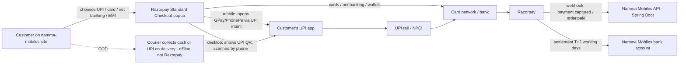

# Payments Guide: Razorpay + UPI for Namma Mobiles

> Audience: the owner (Java full stack fresher) who will implement online payments by following this guide and Razorpay's docs.
> Written: **12 Nov 2026**. Razorpay changes its docs, prices and rules often. Every important claim links to its source (see [Sources](#7-sources)); re-check them before go-live.
> Scope: website checkout (React + Spring Boot). Cash on Delivery stays as it is.

---

## 0. Status of this work (read first)

- **Today:** online payments are fake. `DemoOnlineGateway` marks every UPI/card/EMI/net-banking order `PAID` instantly, and no money moves. COD orders stay `PENDING` until the courier collects.
- **Recommended implementation = section 3.** A first draft of part of it was written on 12 Nov 2026 and then **moved out of the build**. It is kept for reference in **`context/quarantine/razorpay-draft/`**:
  - Classes: `Payment`, `PaymentRepository`, `WebhookEvent`, `WebhookEventRepository`, `razorpay/RazorpayClient`, `razorpay/RazorpaySignatures`.
  - A migration draft, originally named `V6__razorpay_payments.sql`.
  - These files are **not compiled or run**. You may copy them back into `src/main/java/com/mobinest/order/payment/...` when you implement.
- **Migration version:** the draft migration **must be renumbered**. V6 is already taken (`add_iphone_18_pro_max`) and V7 is reserved for the admin work, so use the next free version (**V8 or later**). Check `src/main/resources/db/migration/` first.
- **Already in the code base:** `SkuRepository.incrementStock` and `AccessoryRepository.incrementStock`, used to release stock.
- **Everything else in section 3 still has to be written:**
  - `PENDING_PAYMENT` status;
  - `AppProperties.razorpay` and the yml block;
  - `CustomerOrder.paymentDueAt` / `paidAt`;
  - `OrderRepository.findIdsDueBefore`;
  - `RazorpayGateway`, `PaymentService`, the verify and webhook controllers, the expiry job;
  - the `SecurityConfig` and `OrderService` changes;
  - the frontend and tests.

---

## 1. Quick answers

### Q1. "Is Razorpay integration alone sufficient, or is it separate?"

**For taking online payments on the website, yes: one Razorpay integration is enough.** Razorpay **Standard Checkout** is a single payment popup that already contains every common method. By default it includes **UPI, debit and credit cards, net banking, wallets and card EMI** ([payment methods](https://razorpay.com/docs/payments/payment-methods/)). You do **not** build a separate UPI, card or net-banking integration.

"Integration" means more than adding the popup, though. To run a real shop you also need:

1. **Server-side work in our Spring Boot API.** Create a Razorpay order, verify the payment signature, receive webhooks, and expire unpaid orders (section 3).
2. **An activated live account (KYC)** and the **policy pages** Razorpay checks before it issues live keys (section 5).
3. **Things Razorpay does not do for you:** Cash on Delivery (we keep our own), GST invoices to customers, shipping, and returns logistics.

**NEFT / RTGS / IMPS (bank transfers):** these are **not** part of the default checkout. Razorpay offers them as a separate method called **Bank Transfer**. It is an *on-demand* feature that needs approval from Razorpay Support plus extra integration ([bank transfer](https://razorpay.com/docs/payments/payment-methods/bank-transfer/), [payment methods](https://razorpay.com/docs/payments/payment-methods/)):

- The customer is shown an account number and IFSC (a "Customer Identifier") and pays from their own bank's site or app.
- These payments are auto-captured.
- You learn about them through the `virtual_account.credited` webhook.

The Razorpay page doesn't name NEFT, RTGS or IMPS individually; it only shows `"mode": "NEFT"` in a sample payload. Ask Razorpay Support which transfer modes they support for your account.

**Recommendation:** launch without Bank Transfer. Customers who want to pay from their bank account can use **net banking** or **UPI** (both are bank-account payments, enabled by default, and confirmed instantly). Add Bank Transfer later only if big-ticket buyers ask for it.

| Customer wants to pay by | Covered by the standard Razorpay integration? |
|---|---|
| UPI (GPay, PhonePe, Paytm, BHIM...) | ✅ Yes, inside Checkout |
| Debit / credit card (Visa, Mastercard, RuPay, Amex) | ✅ Yes |
| Net banking | ✅ Yes |
| Wallets, card EMI | ✅ Yes |
| NEFT / RTGS / IMPS bank transfer | ⚠️ Separate "Bank Transfer" feature: needs Razorpay approval + extra code |
| Cardless EMI, Pay Later | ⚠️ Needs Razorpay approval |
| Cash on Delivery | Our own flow (already built). Razorpay's own COD needs approval and we don't need it. |

### Q2. "Is Razorpay separate from a UPI QR code, or from paying directly via UPI in the mobile app? Same thing or different?"

**UPI is the payment rail (run by NPCI). Razorpay is a payment gateway that lets your website accept UPI and other methods, and confirms each payment to your server.** When a customer picks UPI inside Razorpay Checkout, they *are* paying by UPI in GPay or PhonePe; Razorpay is in the middle. The options people mix up are:

| Option | What it is | Right for our website? |
|---|---|---|
| **Razorpay Standard Checkout** (UPI inside it) | One popup. On a **phone**, UPI opens the customer's UPI app ("intent"). On a **desktop**, the customer scans a **QR** shown in the popup with their phone. Razorpay tells our server the payment succeeded and settles the money to our bank. | ✅ **Yes: this is the one.** No separate UPI integration needed. |
| **Razorpay QR Codes API** | A QR (static or dynamic) that you create for your business, for example printed at a shop counter or put on an invoice. You must ask Razorpay to enable it. ([QR Codes](https://razorpay.com/docs/payments/qr-codes/)) | ❌ Not for website checkout. Useful later for a physical store. |
| **Razorpay Payment Links** | A link you send by SMS, email or social media. The customer pays by UPI, card, net banking and so on. No website needed. Links can expire. ([Payment Links](https://razorpay.com/docs/payments/payment-links/)) | ❌ Not for checkout. ✅ Handy for phone or WhatsApp orders, or collecting a balance. These work even before your website is approved ([website details](https://razorpay.com/docs/payments/dashboard/account-settings/business-website-details/)). |
| **Raw `upi://pay?pa=you@bank&am=...` link or your personal UPI QR, no gateway** | The customer pays your UPI ID directly. | ❌ **No.** See below. |

**Why a raw UPI link or personal QR is not suitable for an online store:**

- **No automatic confirmation.** Your server never learns that a payment happened. The customer can click "I've paid" without paying. You would have to check your bank app by hand for every order.
- **No reliable matching to an order.** You can't prove which UPI credit belongs to which order. Customers can change the amount or note, or pay twice.
- **No webhooks, no reconciliation reports, no refund API.** Refunds and disputes are manual bank transfers.
- **No cards, net banking or EMI.** Most ₹50,000+ phone buyers want cards or EMI.
- **Personal UPI IDs are meant for person-to-person payments.** Using one for business collections is not the intended use and is a commercial and compliance risk. A business needs a merchant (P2M) setup, which is what a gateway gives you.

**UPI facts that matter (with sources):**

- **UPI Collect (typing a UPI ID or VPA) is being deprecated.** Razorpay's UPI page says: *"According to NPCI guidelines, the UPI Collect flow is being deprecated effective 28 February 2026. Customers can no longer make payments ... by manually entering VPA/UPI id/mobile numbers."* Some exemptions exist. New merchants should use **UPI Intent** on mobile and a **UPI QR** on desktop ([UPI](https://razorpay.com/docs/payments/payment-methods/upi/)). Standard Checkout handles this for us. We should not build a "type your UPI ID" box.
- **Mobile web intent support is narrow.** Razorpay's UPI page says Intent on *mobile web* works only with PhonePe and Google Pay, on Chrome. Other customers can still scan the QR or pay by another method ([UPI](https://razorpay.com/docs/payments/payment-methods/upi/)).
- **UPI amount limits:** I could not verify them. Razorpay's UPI limits page returned **404**. Limits are set by NPCI and banks, can differ by category and bank, and change over time. Expensive phones may exceed a customer's UPI limit, so keep cards, EMI and net banking available.
- **UPI Autopay** is for subscriptions and recurring mandates. We sell one-off orders, so we don't need it.

### Q3. "How can I actually make sure a payment really happened?"

**Never trust the browser.** Anyone can edit JavaScript and call your API with "paid: true". Confirm on the server using four layers:

1. **Create the Razorpay order on the server**, with the amount in paise computed from *our* database total. The browser only receives the `order_id`, so it cannot change the price. Razorpay notes that payments made without an `order_id` cannot be captured and are automatically refunded ([integration steps](https://razorpay.com/docs/payments/payment-gateway/web-integration/standard/integration-steps/)).
2. **Verify the Checkout signature on the server.** After payment, Checkout returns `razorpay_payment_id`, `razorpay_order_id` and `razorpay_signature`. Compute `HMAC_SHA256(order_id + "|" + razorpay_payment_id, key_secret)` and compare. Razorpay says to use the `order_id` **stored on your server**, not the one returned by Checkout, and *"You must verify the signature on your server before fulfilling the order"* ([integration steps](https://razorpay.com/docs/payments/payment-gateway/web-integration/standard/integration-steps/)).
3. **Webhooks are the source of truth.** Razorpay calls our server (`payment.captured`, `order.paid`, `payment.failed`) even if the customer closed the tab right after paying. Verify the `X-Razorpay-Signature` header with the **webhook secret** over the **raw body**. Handle duplicates using `x-razorpay-event-id` ([validate & test](https://razorpay.com/docs/webhooks/validate-test/), [best practices](https://razorpay.com/docs/webhooks/best-practices/)). Razorpay calls webhooks *"the primary and most efficient method for event notifications"* ([integration steps](https://razorpay.com/docs/payments/payment-gateway/web-integration/standard/integration-steps/)).
4. **Fetch the status from Razorpay's API when in doubt.** Do this before cancelling an "unpaid" order, or when a webhook is late: `GET /v1/orders/{id}/payments` or `GET /v1/payments/{id}`. Then check `status == "captured"` **and** that `amount` equals our amount ([fetch payments](https://razorpay.com/docs/api/orders/fetch-payments/)).

Two more safeguards:

- **Idempotency.** The verify call, the webhook and the expiry job may all see the same payment. Lock the payment row and make "mark as paid" a no-op if it is already paid.
- **Test mode first.** Test keys (`rzp_test_...`) move no money. Test cards and test UPI IDs are in section 4.

Only ship the phone when the order is `CONFIRMED` and payment is `PAID` (captured). Razorpay automatically refunds payments that stay uncaptured, so deliver only after capture ([build integration](https://razorpay.com/docs/payments/payment-gateway/web-integration/standard/build-integration/), [capture settings](https://razorpay.com/docs/payments/payments/capture-settings/)).

---

## 2. How Razorpay and UPI fit together



Sequence for one online order:

```mermaid
sequenceDiagram
    participant B as Browser (React Checkout.jsx)
    participant A as Our API (Spring Boot)
    participant R as Razorpay
    B->>A: POST /api/orders {items, address, paymentMethod: "upi"}
    A->>A: price from DB, reserve stock, status PENDING_PAYMENT, due in 30 min
    A->>R: POST /v1/orders {amount (paise), currency INR, receipt = our order number}
    R-->>A: {id: "order_XXXX"}
    A-->>B: 201 order + razorpay {keyId, orderId, amount}
    B->>R: open checkout.js with order_id
    R-->>B: handler({razorpay_payment_id, razorpay_order_id, razorpay_signature})
    B->>A: POST /api/payments/verify
    A->>A: HMAC check with key_secret (+ fetch payment, compare amount)
    A-->>B: order CONFIRMED / PAID
    R->>A: POST /api/webhooks/razorpay (order.paid) - signed with webhook secret
    A->>A: verify signature on raw body, skip if event id seen, mark paid (no-op if already)
    Note over A: Every minute: PENDING_PAYMENT orders past due -> ask Razorpay; paid? confirm : cancel + release stock
```

**COD and UPI on delivery** is a separate, offline flow. The courier collects cash or a UPI payment on their own device, and the money reaches us through the courier's COD remittance. It does not touch Razorpay or our API. The COD order stays `CONFIRMED` with payment `PENDING` until we mark it paid (an admin feature for later).

---

## 3. Step by step for this project

### 3.1 Order and payment status flow

| Situation | `orders.status` | `orders.payment_status` | Stock |
|---|---|---|---|
| COD placed (unchanged) | `CONFIRMED` | `PENDING` | reserved |
| Online order placed, popup not yet paid | **`PENDING_PAYMENT`** ("Awaiting payment") | `PENDING` | reserved until `payment_due_at` |
| Payment verified (verify call or webhook) | `CONFIRMED` | `PAID` | kept |
| A payment attempt failed (customer can retry in the popup) | `PENDING_PAYMENT` | `PENDING` (failure recorded on the `payment` row) | reserved |
| Window (30 min) passed and Razorpay confirms nothing captured | `CANCELLED` | `FAILED` | **released** |
| Late payment arrives after cancellation | `CANCELLED` | `REFUNDED` (auto-refund) | stays released |
| Refund done from the Razorpay Dashboard | unchanged | `REFUNDED` (via `refund.processed` webhook) | admin decides |

Rules:

- Only `CONFIRMED` orders get the confirmation email. Today `OrderPlacedEvent` is published in `placeOrder`; for online orders, publish it from "mark paid" instead.
- `status` is `VARCHAR(20)`, so `PENDING_PAYMENT` (15 characters) fits without a schema change.
- Match Razorpay's capture window to our expiry. Capture is automatic by default, within 3 days. Custom auto-capture timeouts can be as short as 12 minutes, and payments not captured in time are auto-refunded ([capture settings](https://razorpay.com/docs/payments/payments/capture-settings/)). In **Dashboard → Account & Settings → Payment Capture**, set an auto-capture timeout **≤ our 30 min window** (for example 15 minutes). That way a payment that authorises very late is refunded by Razorpay rather than captured for an order we already cancelled. Our late-payment auto-refund (below) is the second safety net.

### 3.2 Database: Flyway `V8__razorpay_payments.sql` (or the next free version)

V6 is taken (`add_iphone_18_pro_max`) and V7 is reserved for the admin work, so use **V8 or later**. Flyway refuses duplicate versions, so check the folder just before adding the file. The draft lives in `context/quarantine/razorpay-draft/` (originally named V6); rename it when you move it to `src/main/resources/db/migration/`. Contents:

```sql
ALTER TABLE orders
    ADD COLUMN payment_due_at DATETIME(6) NULL AFTER payment_reference,
    ADD COLUMN paid_at        DATETIME(6) NULL AFTER payment_due_at,
    ADD INDEX idx_order_status_due (status, payment_due_at);

CREATE TABLE payment (                       -- one row per online order
    id                  BIGINT AUTO_INCREMENT PRIMARY KEY,
    order_id            BIGINT       NOT NULL,
    provider            VARCHAR(20)  NOT NULL,          -- RAZORPAY
    provider_order_id   VARCHAR(40)  NOT NULL,          -- order_XXXX
    provider_payment_id VARCHAR(40),                    -- pay_XXXX
    signature           VARCHAR(128),
    status              VARCHAR(20)  NOT NULL,          -- PENDING | PAID | FAILED | REFUNDED
    amount_paise        BIGINT       NOT NULL,          -- ₹1 = 100
    currency            CHAR(3)      NOT NULL DEFAULT 'INR',
    method              VARCHAR(20),                    -- upi | card | netbanking ...
    error_code          VARCHAR(60),
    error_description   VARCHAR(255),
    refunded_paise      BIGINT       NOT NULL DEFAULT 0,
    last_refund_id      VARCHAR(40),
    created_at DATETIME(6) NOT NULL DEFAULT CURRENT_TIMESTAMP(6),
    updated_at DATETIME(6) NOT NULL DEFAULT CURRENT_TIMESTAMP(6) ON UPDATE CURRENT_TIMESTAMP(6),
    CONSTRAINT uk_payment_order            UNIQUE (order_id),
    CONSTRAINT uk_payment_provider_order   UNIQUE (provider_order_id),
    CONSTRAINT uk_payment_provider_payment UNIQUE (provider_payment_id),
    CONSTRAINT fk_payment_order FOREIGN KEY (order_id) REFERENCES orders (id),
    CONSTRAINT chk_payment_amount CHECK (amount_paise >= 100)
) ENGINE = InnoDB;

CREATE TABLE payment_webhook_event (         -- idempotency + audit
    event_id            VARCHAR(64) PRIMARY KEY,         -- x-razorpay-event-id
    event_type          VARCHAR(60) NOT NULL,
    provider_order_id   VARCHAR(40),
    provider_payment_id VARCHAR(40),
    payload             MEDIUMTEXT  NOT NULL,            -- raw body, exactly as received
    received_at DATETIME(6) NOT NULL DEFAULT CURRENT_TIMESTAMP(6),
    INDEX idx_webhook_provider_order (provider_order_id)
) ENGINE = InnoDB;
```

Why store **paise as an integer**: Razorpay requires the amount as a JSON integer in the smallest unit (₹299 → `29900`), with a minimum of ₹1 ([Orders API](https://razorpay.com/docs/api/orders/create/)). Converting from our `DECIMAL(12,2)` total: `total.setScale(2).movePointRight(2).longValueExact()`.

Remember the project rule: after the change, update `DATABASE.md`, `API.md`, `CHANGELOG.md` and `CONTEXT.md`.

### 3.3 Configuration and secrets

```yaml
# application.yml (no secrets here, only env-var placeholders)
mobinest:
  razorpay:
    key-id: ${RAZORPAY_KEY_ID:}                 # rzp_test_... / rzp_live_... (public, goes to browser)
    key-secret: ${RAZORPAY_KEY_SECRET:}         # SECRET: server only
    webhook-secret: ${RAZORPAY_WEBHOOK_SECRET:} # SECRET: the value you type when creating the webhook
    api-base-url: https://api.razorpay.com/v1
    store-name: Namma Mobiles
    payment-window: ${RAZORPAY_PAYMENT_WINDOW:30m}
    allow-demo: ${PAYMENTS_ALLOW_DEMO:true}     # set PAYMENTS_ALLOW_DEMO=false in production
```

- **Local:** put the three test values in `config/application.properties`, which is already git-ignored:
  ```properties
  mobinest.razorpay.key-id=rzp_test_xxx
  mobinest.razorpay.key-secret=...
  mobinest.razorpay.webhook-secret=...
  ```
- **Production:** set the environment variables `RAZORPAY_KEY_ID`, `RAZORPAY_KEY_SECRET`, `RAZORPAY_WEBHOOK_SECRET` and `PAYMENTS_ALLOW_DEMO=false`.
- **Never** put the key secret or webhook secret in git, in the React app, in `.env` files that Vite bundles, or in logs. Only `key_id` goes to the browser (Checkout needs it as `key`).
- If keys are missing and `allow-demo=false`, refuse online orders with a clear 503 error instead of faking them.

`AppProperties` gets a nested record:

```java
public record Razorpay(String keyId, String keySecret, String webhookSecret, String apiBaseUrl,
        String storeName, Duration paymentWindow, boolean allowDemo) {
    public boolean enabled() { return StringUtils.hasText(keyId) && StringUtils.hasText(keySecret); }
}
```

### 3.4 Talking to Razorpay: SDK or plain HTTP?

| | Official SDK `com.razorpay:razorpay-java` | Plain HTTP (Spring `RestClient`) |
|---|---|---|
| Version | **1.4.10** is the latest on Maven Central (checked 12 Nov 2026, [Maven Central](https://central.sonatype.com/artifact/com.razorpay/razorpay-java)) | n/a |
| Pros | `Utils.verifyPaymentSignature(...)` / `Utils.verifyWebhookSignature(...)` helpers, ready-made calls | No extra dependencies, typed Java records, full control over timeouts and errors |
| Cons | Pulls in its own HTTP and JSON libraries; uses `org.json` objects, not records | You write about 4 small methods and the HMAC check (about 30 lines) |

SDK coordinates, if you prefer it:

```xml
<dependency>
  <groupId>com.razorpay</groupId>
  <artifactId>razorpay-java</artifactId>
  <version>1.4.10</version> <!-- re-check Maven Central for the latest -->
</dependency>
```

The recommended draft uses **plain HTTP** against `https://api.razorpay.com/v1` with HTTP Basic auth (`key_id:key_secret`), as shown in Razorpay's curl samples ([Orders API](https://razorpay.com/docs/api/orders/create/)). See `context/quarantine/razorpay-draft/` → `razorpay/RazorpayClient.java`. It needs `AppProperties.razorpay` from section 3.3 before it compiles. The four calls:

| Call | Endpoint | Used for |
|---|---|---|
| Create order | `POST /orders` `{amount, currency:"INR", receipt, notes}` | At checkout. `receipt` = our order number (max 40 characters, unique) |
| Payments of an order | `GET /orders/{id}/payments` | Expiry job: "did anything get captured?" |
| Fetch payment | `GET /payments/{id}` | Verify call: check `status`, `amount`, `order_id` |
| Refund | `POST /payments/{id}/refund` `{amount?, speed:"normal", receipt}` | Late payments, admin refunds. Without `amount`, refunds everything. Normal speed takes 5 to 7 working days ([Refunds API](https://razorpay.com/docs/api/refunds/create-normal/)) |

Signature helper (`RazorpaySignatures.java`, the key piece):

```java
public static String hmacSha256Hex(byte[] data, String secret) throws Exception {
    Mac mac = Mac.getInstance("HmacSHA256");
    mac.init(new SecretKeySpec(secret.getBytes(UTF_8), "HmacSHA256"));
    return HexFormat.of().formatHex(mac.doFinal(data));
}
// Checkout:  hmac((OUR stored razorpay order id + "|" + razorpay_payment_id).getBytes(UTF_8), keySecret)
// Webhook:   hmac(RAW request body bytes, webhookSecret)  vs header X-Razorpay-Signature
// Compare with MessageDigest.isEqual(...) (constant time), never String.equals
```

### 3.5 `RazorpayGateway` (fits the existing Strategy)

`PaymentGateway` already exists for exactly this purpose. Changes:

1. Extend the result so the order service knows a customer action is pending:
   `record PaymentResult(PaymentStatus status, String reference, String providerOrderId)`. Keep a 2-argument constructor for COD and demo.
2. `DemoOnlineGateway.supports(m)` returns `m != COD && !razorpay.enabled() && razorpay.allowDemo()`, and logs a WARN at startup when active.
3. New gateway:

```java
@Component
@RequiredArgsConstructor
public class RazorpayGateway implements PaymentGateway {
    private final RazorpayClient razorpay;
    private final AppProperties props;

    @Override public boolean supports(PaymentMethod m) {
        return m != PaymentMethod.COD && props.razorpay().enabled();
    }

    @Override public PaymentResult initiate(CustomerOrder order) {
        long paise = order.getTotal().setScale(2).movePointRight(2).longValueExact();
        var rzpOrder = razorpay.createOrder(paise, order.getOrderNumber(),
            Map.of("order_number", order.getOrderNumber(), "email", order.getEmail()));
        return new PaymentResult(PaymentStatus.PENDING, rzpOrder.id(), rzpOrder.id());
    }
}
```

The customer can still choose UPI, card and so on in *our* UI. All of them open the same Razorpay popup, which shows every method. You can optionally pre-select or reorder methods with Checkout's configuration options ([configure payment methods](https://razorpay.com/docs/payments/payment-gateway/web-integration/standard/configure-payment-methods/)). I did not verify the exact option syntax from that page, so check its sample code. The simplest choice is to merge the four online radio buttons into one "Pay online (UPI / Cards / Net banking / EMI)" option.

### 3.6 `OrderService.placeOrder` changes

```java
PaymentResult payment = gatewayFor(method).initiate(order);   // calls Razorpay for online orders
order.setPaymentStatus(payment.status());
order.setPaymentReference(payment.reference());
boolean awaiting = payment.providerOrderId() != null;
order.setStatus(awaiting ? OrderStatus.PENDING_PAYMENT : OrderStatus.CONFIRMED);
if (awaiting) order.setPaymentDueAt(Instant.now().plus(props.razorpay().paymentWindow()));
orders.save(order);

if (awaiting) {
    long paise = order.getTotal().setScale(2).movePointRight(2).longValueExact();
    paymentRepo.save(Payment.razorpay(order, payment.providerOrderId(), paise));
    return mapper.toResponse(order, checkoutFor(order, paise));   // includes the razorpay block below
}
events.publishEvent(new OrderPlacedEvent(...));                   // COD / demo only
return mapper.toResponse(order);
```

- If Razorpay is down, `createOrder` throws a `BusinessRuleException` (502 `PAYMENT_PROVIDER_ERROR`). The whole transaction rolls back, so no order is saved and no stock is taken. The customer can retry or choose COD.
- Handle a missing gateway in `gatewayFor`: throw a 503 `PAYMENTS_UNAVAILABLE` business error instead of `IllegalStateException`.

New field at the end of `OrderResponse` (`null` for COD):

```json
"razorpay": {
  "keyId": "rzp_test_xxx", "orderId": "order_XXXX", "amount": 5499900, "currency": "INR",
  "name": "Namma Mobiles", "description": "Order MNM3K9ZQ2AB7X",
  "prefill": { "name": "Asha", "email": "asha@example.com", "contact": "+919876543210" },
  "expiresAt": "2026-11-12T10:30:00Z"
}
```

### 3.7 `POST /api/payments/verify` (called by the browser after the popup succeeds)

Request: `{ orderNumber, razorpayOrderId, razorpayPaymentId, razorpaySignature }`. This is a public endpoint (guest checkout); the signature is what proves the payment.

```java
@Transactional
public OrderResponse verify(VerifyPaymentRequest req) {
    Payment p = payments.lockByOrderNumber(req.orderNumber())                 // SELECT ... FOR UPDATE
        .orElseThrow(() -> new NotFoundException("Order", req.orderNumber()));
    // Use OUR stored order id, not the one the browser sent.
    if (!RazorpaySignatures.isValidCheckout(p.getProviderOrderId(), req.razorpayPaymentId(),
            req.razorpaySignature(), props.razorpay().keySecret())) {
        throw new BusinessRuleException(HttpStatus.BAD_REQUEST, "PAYMENT_SIGNATURE_INVALID",
            "We could not verify this payment. If money was debited, it will be confirmed or refunded automatically.");
    }
    p.setSignature(req.razorpaySignature());
    try {
        RzpPayment rp = razorpay.fetchPayment(req.razorpayPaymentId());       // belt and braces
        if (!p.getProviderOrderId().equals(rp.orderId()) || rp.amount() != p.getAmountPaise()) {
            throw new BusinessRuleException(HttpStatus.BAD_REQUEST, "PAYMENT_MISMATCH", "Payment does not match this order");
        }
        if (rp.isCaptured()) markPaid(p, rp.id(), rp.method());
        // "authorized" = capture still in progress; the webhook / expiry job will confirm it
    } catch (BusinessRuleException e) {
        if ("PAYMENT_PROVIDER_ERROR".equals(e.getCode())) { /* API down: webhook/expiry job will reconcile */ }
        else throw e;
    }
    return mapper.toResponse(p.getOrder());
}

/** Idempotent. Called from verify, webhook and expiry job. */
void markPaid(Payment p, String paymentId, String method) {
    if (p.getStatus() == PaymentStatus.PAID || p.getStatus() == PaymentStatus.REFUNDED) return;
    CustomerOrder o = p.getOrder();
    p.setProviderPaymentId(paymentId); p.setMethod(method); p.setStatus(PaymentStatus.PAID);
    if (o.getStatus() == OrderStatus.PENDING_PAYMENT) {
        o.setStatus(OrderStatus.CONFIRMED); o.setPaymentStatus(PaymentStatus.PAID);
        o.setPaymentReference(paymentId); o.setPaidAt(Instant.now()); o.setPaymentDueAt(null);
        events.publishEvent(new OrderPlacedEvent(o.getOrderNumber(), o.getEmail(), o.getTotal()));
    } else {                                   // already CANCELLED (expired): stock is gone, refund
        var refund = razorpay.refund(paymentId, null, o.getOrderNumber() + "-LATE",
            Map.of("reason", "order expired before payment"));
        p.setStatus(PaymentStatus.REFUNDED); p.setLastRefundId(refund.id());
        o.setPaymentStatus(PaymentStatus.REFUNDED);
    }
}
```

### 3.8 `POST /api/webhooks/razorpay`

What Razorpay's docs require (sources: [webhooks](https://razorpay.com/docs/webhooks/), [validate & test](https://razorpay.com/docs/webhooks/validate-test/), [best practices](https://razorpay.com/docs/webhooks/best-practices/)):

- **Verify** `X-Razorpay-Signature` = HMAC-SHA256 of the **raw body** with the **webhook secret**. That secret is different from the key secret. *"Do not parse or cast the webhook request body"* before verifying.
- **Duplicates happen** (at-least-once delivery). Deduplicate with the `x-razorpay-event-id` header.
- **Order is not guaranteed.** `payment.captured` may arrive before `payment.authorized`.
- **Respond 2xx within 5 seconds.** Otherwise Razorpay retries with exponential backoff for 24 hours, then **disables the webhook** and emails you.
- **Endpoint rules:** HTTPS with TLS 1.2+, port 80 or 443 only, and whitelist Razorpay's webhook IPs if you use a firewall.
- **Events to subscribe** (Dashboard → Webhooks, separately for Test and Live): `payment.captured`, `payment.failed`, `order.paid`, plus `refund.processed` (check the exact refund event names in the Dashboard list), and `virtual_account.credited` only if you enable Bank Transfer later ([payment events](https://razorpay.com/docs/webhooks/payments/)).

```java
@RestController
@RequiredArgsConstructor
class RazorpayWebhookController {
    private final PaymentService payments;

    @PostMapping(path = "/api/webhooks/razorpay", consumes = MediaType.ALL_VALUE)
    ResponseEntity<Void> receive(@RequestBody byte[] raw,                         // raw bytes, not a DTO
            @RequestHeader(name = "X-Razorpay-Signature", required = false) String signature,
            @RequestHeader(name = "x-razorpay-event-id", required = false) String eventId) {
        payments.handleWebhook(raw, signature, eventId);   // throws 400 on a bad signature
        return ResponseEntity.ok().build();
    }
}
```

```java
@Transactional
public void handleWebhook(byte[] raw, String signature, String eventId) {
    if (!RazorpaySignatures.isValidWebhook(raw, signature, props.razorpay().webhookSecret()))
        throw new BusinessRuleException(HttpStatus.BAD_REQUEST, "WEBHOOK_SIGNATURE_INVALID", "Invalid signature");
    if (eventId == null || webhookEvents.existsById(eventId)) return;     // duplicate: just 200

    JsonNode root = JSON.readTree(raw);                   // tools.jackson (Jackson 3) JsonMapper
    String type = root.path("event").asString();
    JsonNode pay = root.path("payload").path("payment").path("entity");
    String rzpOrderId = pay.path("order_id").asString();

    switch (type) {
        case "payment.captured", "order.paid" -> payments.lockByProviderOrderId(rzpOrderId).ifPresent(p -> {
            if (pay.path("amount").asLong() == p.getAmountPaise()) markPaid(p, pay.path("id").asString(), pay.path("method").asString());
            else log.error("Amount mismatch for {}", rzpOrderId);
        });
        case "payment.failed" -> payments.lockByProviderOrderId(rzpOrderId).ifPresent(p -> {
            if (p.getStatus() == PaymentStatus.PENDING) {      // customer may still retry in the popup
                p.setErrorCode(pay.path("error_code").asString());
                p.setErrorDescription(pay.path("error_description").asString());
            }
        });
        case "refund.processed" -> { /* payload.refund.entity: add amount to refunded_paise; if full, mark REFUNDED */ }
        default -> { /* ignore other events (e.g. payment links) */ }
    }
    webhookEvents.save(newEvent(eventId, type, rzpOrderId, pay.path("id").asString(), new String(raw, UTF_8)));
}
```

Notes:

- Everything runs in one transaction. If processing fails (for example the refund API is down), the event row rolls back too, we return 500, and Razorpay retries later.
- `payment.failed` does **not** cancel the order. The same Razorpay order accepts more attempts until one is captured ([Orders API](https://razorpay.com/docs/api/orders/create/)). The expiry job cancels the order.
- Unknown order IDs (Payment Links, Dashboard payments) are stored and ignored.

### 3.9 `SecurityConfig`

```java
.requestMatchers(HttpMethod.POST, "/api/orders", "/api/coupons/validate",
                 "/api/payments/verify", "/api/webhooks/razorpay").permitAll()
```

- The webhook is server-to-server: no Clerk token, no CORS. The HMAC signature is its authentication.
- CSRF is already disabled (stateless API).
- Never log full webhook bodies at INFO in production; they contain customer emails and phone numbers.

### 3.10 Expiry job (release stock of unpaid orders)

```java
@Component
@RequiredArgsConstructor
class PaymentExpiryJob {
    @Scheduled(fixedDelayString = "PT1M", initialDelayString = "PT30S")
    void run() {
        if (!props.razorpay().enabled()) return;
        for (Long id : orders.findIdsDueBefore(OrderStatus.PENDING_PAYMENT, Instant.now(), PageRequest.of(0, 50))) {
            try { payments.expireOrReconcile(id); } catch (Exception e) { log.warn("Expiry of order {} failed, will retry", id, e); }
        }
    }
}
```

`expireOrReconcile(orderId)` (`@Transactional`) works like this:

1. Lock the payment row. If the order is no longer `PENDING_PAYMENT`, return.
2. **Ask Razorpay first** with `GET /orders/{id}/payments`.
   - Any `captured` payment → `markPaid`.
   - Any `authorized` payment → wait for the next run, because capture is in progress.
   - Otherwise → order `CANCELLED`, payment `FAILED`, and `incrementStock` for each line (`sku` or `accessory`).
3. If the Razorpay API is unreachable, do nothing; it retries next minute. **Never cancel without checking.**

Add `@EnableScheduling` to `MobinestApiApplication`. If you ever run two API instances, use ShedLock or similar so only one runs the job; the row locks already prevent double updates.

### 3.11 Refunds

- **For now:** refund from the **Razorpay Dashboard** (Transactions → Payments → Refund). The `refund.processed` webhook updates our DB.
- **Code path:** `razorpay.refund(paymentId, amountPaise or null, receipt, notes)` with a **unique `receipt`** per refund (for example `MNxxxx-R1`). Reusing a receipt returns a duplicate error, which protects against double refunds ([Refunds API](https://razorpay.com/docs/api/refunds/create-normal/)).
  - Speeds: `normal` takes 5 to 7 working days. `optimum` is instant where possible and may cost extra; check pricing.
  - Normal refunds are not possible for payments older than 6 months.
- **Admin endpoint later:** `POST /api/admin/orders/{orderNumber}/refund` sits under the existing `/api/admin/**` rule. That rule needs an ADMIN role mapped from Clerk, which doesn't exist yet.
- **Policy text:** the site's returns page says refunds go "to the original payment method within 5–7 business days". That matches Razorpay's normal refund speed.

### 3.12 Frontend (`mobinest/src`)

1. **`services/api.js`:** add the endpoint.
   ```js
   verifyPayment: (payload) => api('/api/payments/verify', { method: 'POST', body: payload, timeout: 20000 }),
   ```
2. **Load Checkout once** with a new helper, `utils/razorpay.js`:
   ```js
   let loading
   export function loadRazorpay() {
     if (window.Razorpay) return Promise.resolve(true)
     loading ??= new Promise((resolve) => {
       const s = document.createElement('script')
       s.src = 'https://checkout.razorpay.com/v1/checkout.js'
       s.onload = () => resolve(true)
       s.onerror = () => { loading = undefined; resolve(false) }
       document.body.appendChild(s)
     })
     return loading
   }
   ```
3. **`pages/Checkout.jsx`:** after `endpoints.placeOrder(...)` returns:
   ```js
   if (order.razorpay) {
     setPendingOrder(order)          // keep it: "Pay now" again re-opens the SAME Razorpay order (no new stock reservation)
     return openRazorpay(order)
   }
   // COD / demo: unchanged -> addOrder, clearCart, navigate

   async function openRazorpay(order) {
     if (!(await loadRazorpay())) { toast('Could not load the payment window. Check your connection.', { type: 'error' }); setSubmitting(false); return }
     const r = order.razorpay
     const rzp = new window.Razorpay({
       key: r.keyId, order_id: r.orderId, amount: r.amount, currency: r.currency,
       name: r.name, description: r.description, prefill: r.prefill,
       theme: { color: '#0a5bd3' },
       handler: async (resp) => {                       // success: VERIFY ON SERVER before showing success
         try {
           const confirmed = await endpoints.verifyPayment({
             orderNumber: order.id,
             razorpayOrderId: resp.razorpay_order_id,
             razorpayPaymentId: resp.razorpay_payment_id,
             razorpaySignature: resp.razorpay_signature,
           })
           addOrder(confirmed); setPlaced(true); clearCart(); navigate(`/order/${confirmed.id}`, { replace: true })
         } catch (err) {
           toast('Payment received, confirming with the bank. Check My Orders in a minute.', { type: 'info', duration: 8000 })
         }
       },
       modal: { ondismiss: () => { setSubmitting(false); toast('Payment not completed. Your items are reserved for 30 minutes - tap Pay now to retry.', { type: 'info' }) } },
     })
     rzp.on('payment.failed', (resp) => toast(resp.error?.description || 'Payment failed. Please try again.', { type: 'error' }))
     rzp.open()
   }
   ```
   - Use `handler` rather than `callback_url` for web; Razorpay says `callback_url` is for WebView and redirect flows ([integration steps](https://razorpay.com/docs/payments/payment-gateway/web-integration/standard/integration-steps/)).
   - Format `prefill.contact` as `+91` plus the 10-digit number.
   - When `pendingOrder` is set, the submit button should read "Pay now · ₹…" and call `openRazorpay(pendingOrder)` instead of placing a new order.
4. **Remove the demo text and fallbacks before launch:**
   - Remove the line *"Demo payment: no money is charged."* (or show it only in demo mode).
   - Remove the **"server unreachable → save order locally in demo mode"** fallback for online methods. A real shop must never show "order placed" when the server didn't confirm it.
5. **No separate UPI code.** UPI intent on phones and the QR on desktop appear inside Razorpay Checkout automatically.
6. **COD is unchanged.**

### 3.13 Tests to add

- **Unit test `RazorpaySignatures`:** a known vector (generate one with `openssl dgst -sha256 -hmac "secret"` over `order_X|pay_Y`), a wrong signature, a modified body.
- **`markPaid` idempotency:** calling it twice gives one confirmation event. A late payment on a `CANCELLED` order triggers a refund.
- **Expiry:** a due order with no captured payment is cancelled and its stock goes back up. An `authorized` payment is left alone.
- **Webhook:** a duplicate event ID is skipped. A bad signature returns 400.
- **Mock `RazorpayClient`** in tests. Never call Razorpay from CI.

---

## 4. Testing locally (Test Mode)

1. **Create test keys.** Sign up at Razorpay; Test Mode works before KYC. Go to Dashboard → Test mode → Account & Settings → API Keys and generate `rzp_test_...` plus a secret. Put them in `config/application.properties`. Restart the API, then place an online order: the response should contain a `razorpay` block.
2. **Test cards.** Use any future expiry and any CVV ([test cards](https://razorpay.com/docs/payments/payments/test-card-details/)).

   | Card | Number |
   |---|---|
   | Visa debit | 4100 2800 0000 1007 |
   | Mastercard credit | 5555 5100 0008 1006 |
   | RuPay credit | 6527 6589 0000 1005 |
   | Failure (e.g. `insufficient_fund`, Visa) | 4100 2800 0008 0001 |

   On the test bank page, an OTP of 4 to 10 digits succeeds and fewer than 4 digits fails.
3. **Test UPI.** `success@razorpay` succeeds and `failure@razorpay` fails ([test UPI](https://razorpay.com/docs/payments/payments/test-upi-details/)).
   - In Test Mode, *cancelling* a UPI payment counts as a success. To test cancellation you need Live Mode.
   - These IDs are entered through the UPI-ID (collect) field. With UPI Collect being deprecated for live payments, I couldn't confirm whether Test-mode Checkout still shows that field. If it doesn't, use the test QR or intent simulation that Test-mode Checkout offers, or test with cards.
4. **Webhooks need a public HTTPS URL.** *"You cannot use localhost directly to receive webhook events"* ([validate & test](https://razorpay.com/docs/webhooks/validate-test/)).
   - Use a tunnel to `localhost:8080`. **Note:** Razorpay's page says common tunnels **including ngrok are on its blocked list**. It suggests **zrok**. Request-inspector sites like webhook.site and requestbin are blocked too.
   - Steps: install zrok, run `zrok share public localhost:8080`, and copy the HTTPS URL. In **Test mode**, go to Dashboard → Webhooks → Add: URL `https://<tunnel>/api/webhooks/razorpay`, a secret of your choice (put the same value in `mobinest.razorpay.webhook-secret`), and the events from section 3.8.
   - Webhook URLs in Test and Live mode are configured separately ([webhooks](https://razorpay.com/docs/webhooks/)).
5. **Scenarios to run:**
   - [ ] Pay by card: the verify call confirms the order, the webhook arrives, and the webhook row is saved with no second confirmation.
   - [ ] Pay, then close the tab before `handler` runs: the webhook alone confirms the order.
   - [ ] Failure card / `failure@razorpay`: the order stays `PENDING_PAYMENT`. Retry in the same popup succeeds.
   - [ ] Dismiss the popup and wait past the window (set `RAZORPAY_PAYMENT_WINDOW=2m` for testing): the order becomes `CANCELLED` and stock returns.
   - [ ] Tamper: call `/api/payments/verify` with a random signature: 400. POST to the webhook without a valid signature: 400.
   - [ ] Re-send the same webhook (Dashboard or replay): processed once.
   - [ ] Refund from the Dashboard: our DB shows `REFUNDED`.
   - [ ] COD still works exactly as before.

---

## 5. Go-live checklist

**Account and KYC** ([account setup](https://razorpay.com/docs/payments/set-up/))

- [ ] Complete activation:
  - business type;
  - PAN (business PAN and authorised signatory PAN for registered businesses);
  - GSTIN and certificate, or choose "I don't have a GSTIN";
  - bank account (Razorpay deposits ₹1 to verify it);
  - identity proof.
- [ ] Account state is **`activated`**. Live mode is enabled only after Razorpay verifies your details.

**Website details and policy pages.** Without these, Razorpay does not give you **live API keys** for website payments; only Dashboard Invoices and Payment Links work ([website details](https://razorpay.com/docs/payments/dashboard/account-settings/business-website-details/)). Razorpay asks for links to About us, Contact us, Pricing details, Terms and conditions, Privacy policy and Refunds policy, plus a sample invoice and test login credentials if login is required. Its international-payments page also lists a **Shipping policy**. What our site has today:

| Required page | Namma Mobiles today | Action |
|---|---|---|
| Refund / cancellation policy | ⚠️ `/help/returns` covers returns and refunds (7 days, 5–7 business days to original method) but **not cancellation before shipping** | Add a cancellation section (before dispatch, unpaid orders auto-cancel after 30 min) |
| Shipping policy | ✅ `/help/shipping` | Add delivery areas and timelines |
| Warranty | ✅ `/help/warranty` (extra, good) | none |
| Terms and conditions | ❌ missing | Create `/help/terms` |
| Privacy policy | ❌ missing | Create `/help/privacy` (Clerk accounts, order data, Razorpay as processor) |
| Contact us | ❌ missing | Create `/help/contact`: registered business name, address, phone, email |
| About us | ❌ missing | Create `/help/about` |
| Pricing details | ✅ prices are shown on product pages (₹, incl. shipping rule) | Make sure prices are visible without login |

`Help.jsx` says the current copy is a placeholder to be legally reviewed before launch. Link every policy page from the footer.

**Technical**

- [ ] Real domain on **HTTPS**. The API is reachable publicly for the webhook (port 443, TLS 1.2+).
- [ ] Generate **Live** keys (`rzp_live_...`) and set `RAZORPAY_KEY_ID` and `RAZORPAY_KEY_SECRET` as production environment variables. Never commit them. Razorpay reminds you to swap test keys for live keys before accepting real payments ([integration steps](https://razorpay.com/docs/payments/payment-gateway/web-integration/standard/integration-steps/)).
- [ ] Create the **Live-mode webhook**: `https://api.<your-domain>/api/webhooks/razorpay`, a new strong secret in `RAZORPAY_WEBHOOK_SECRET`, and the same events as in test. Set an Alert Email so you hear if it gets disabled ([best practices](https://razorpay.com/docs/webhooks/best-practices/)). Whitelist Razorpay's webhook IPs if a firewall sits in front of the API.
- [ ] `PAYMENTS_ALLOW_DEMO=false`. `CORS_ALLOWED_ORIGINS` and `CLERK_AUTHORIZED_PARTIES` are set to the real site URL.
- [ ] Payment Capture setting: automatic, with a timeout ≤ our payment window (section 3.1).
- [ ] Run one small real payment (for example a ₹1 test product, or your own order) end to end, refund it, and check that the webhook and DB rows match.
- [ ] Remove the frontend demo text and the offline demo fallback (section 3.12).

**Money**

- [ ] **Settlement:** standard **T+2 working days** after capture. Instant settlement is an on-demand paid option. The cycle can vary by business and risk ([settlements](https://razorpay.com/docs/payments/settlements/)).
- [ ] **Fees** (from the pricing page, fetched 12 Nov 2026; **re-check before signing**, prices change and can be negotiated) ([pricing](https://razorpay.com/pricing/)):
  - **2% platform fee** per successful domestic transaction for cards, UPI, net banking, wallets and EMI;
  - 2.15% for corporate or business credit cards; up to 3% for international cards;
  - **18% GST** on the fee; no setup, annual or refund fees.
  - The page says UPI and RuPay debit carry **zero MDR** per RBI policy, but Razorpay still charges its 2% as a "platform/technology fee".
  - A search result mentioned a 0% platform-fee offer for new merchants for 90 days. I did not verify it, so ask Razorpay.
  - A ₹50,000 phone at 2% + GST costs about ₹1,180 in fees. Factor that into pricing, or into COD versus prepaid incentives.
- [ ] **GST invoices:** you must issue the tax invoice to the customer for every order. Razorpay does not do this for you, and the sample invoice is part of activation. Keep Razorpay's fee invoices for input tax credit. Confirm the details with a CA.
- [ ] **PCI DSS:** with Standard Checkout, the customer types card details into Razorpay's popup, not our form, so card data never touches our servers and our PCI scope stays minimal. Never build your own card form.
- [ ] Reconcile weekly: Razorpay Dashboard settlements against `payment` rows with status `PAID` against shipped orders.

---

## 6. Glossary

| Term | Meaning |
|---|---|
| Razorpay **order** (`order_...`) | Created by our server with the amount. One order can have many payment attempts and becomes `paid` once a payment is captured ([Orders API](https://razorpay.com/docs/api/orders/create/)) |
| **Payment** (`pay_...`) | One attempt. Statuses: `created`, `authorized`, `captured`, `refunded`, `failed` ([fetch payments](https://razorpay.com/docs/api/orders/fetch-payments/)) |
| **Authorized vs captured** | Authorized = the bank approved and holds the money. Captured = moved to us for settlement. Uncaptured payments are auto-refunded ([capture settings](https://razorpay.com/docs/payments/payments/capture-settings/)) |
| **key_id / key_secret** | API keys. key_id is public; key_secret is server-only |
| **Webhook secret** | A separate secret you choose per webhook, used to sign webhook bodies |
| **Paise** | ₹1 = 100 paise. Razorpay amounts are integers in paise |
| **UPI Intent / QR / Collect** | Open the UPI app (mobile) / scan a code (desktop) / type a UPI ID (being deprecated) |

---

## 7. Sources

All fetched or checked on 12 Nov 2026.

- Standard Checkout integration steps: https://razorpay.com/docs/payments/payment-gateway/web-integration/standard/integration-steps/
- Standard Checkout build integration (order states, verify status): https://razorpay.com/docs/payments/payment-gateway/web-integration/standard/build-integration/
- Configure payment methods on Checkout: https://razorpay.com/docs/payments/payment-gateway/web-integration/standard/configure-payment-methods/
- Orders API, create: https://razorpay.com/docs/api/orders/create/
- Fetch payments of an order: https://razorpay.com/docs/api/orders/fetch-payments/
- Refunds API (create normal refund): https://razorpay.com/docs/api/refunds/create-normal/
- Capture settings: https://razorpay.com/docs/payments/payments/capture-settings/
- Webhooks overview: https://razorpay.com/docs/webhooks/
- Webhooks validate & test (signature, raw body, event id, localhost/ngrok note): https://razorpay.com/docs/webhooks/validate-test/
- Webhooks best practices (5 s, retries 24 h, auto-disable, TLS, IPs): https://razorpay.com/docs/webhooks/best-practices/
- Payment webhook events: https://razorpay.com/docs/webhooks/payments/
- Payment methods (defaults vs approval): https://razorpay.com/docs/payments/payment-methods/
- UPI (intent, collect deprecation 28 Feb 2026): https://razorpay.com/docs/payments/payment-methods/upi/
- UPI Collect migration announcements: https://razorpay.com/docs/announcements/upi-collect-migration/s2s-integration
- Bank Transfer (NEFT/RTGS/IMPS via Customer Identifier): https://razorpay.com/docs/payments/payment-methods/bank-transfer/
- QR Codes: https://razorpay.com/docs/payments/qr-codes/
- Payment Links: https://razorpay.com/docs/payments/payment-links/
- Test cards: https://razorpay.com/docs/payments/payments/test-card-details/
- Test UPI IDs: https://razorpay.com/docs/payments/payments/test-upi-details/
- Account setup / KYC: https://razorpay.com/docs/payments/set-up/
- Business website details (policy pages, live keys): https://razorpay.com/docs/payments/dashboard/account-settings/business-website-details/
- Settlements: https://razorpay.com/docs/payments/settlements/
- Pricing: https://razorpay.com/pricing/
- razorpay-java on Maven Central: https://central.sonatype.com/artifact/com.razorpay/razorpay-java

**Could not verify:**

- **UPI transaction limits:** https://razorpay.com/docs/payments/payment-methods/upi/transaction-limits/ returned 404.
- **The 0% platform-fee offer for new merchants:** seen only in a search snippet.
- **The exact `config.display` and `method` Checkout option syntax:** not on the page fetched.
- **Whether Test-mode Checkout still shows the UPI-ID field after the Collect deprecation.**
- **The exact refund webhook event names.** Confirm them in the Dashboard's event list.
